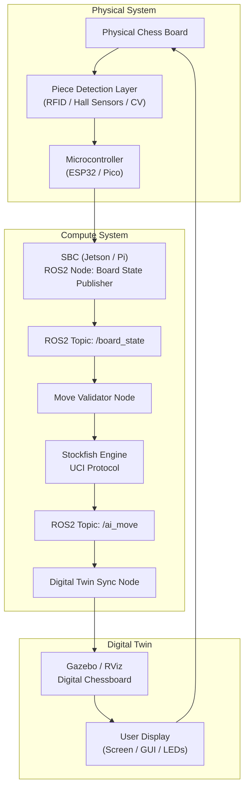
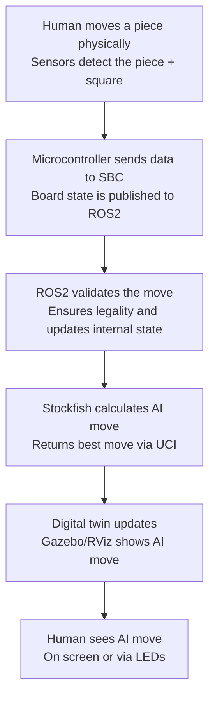

# Robotic Chess System — Phase 1 Project Specification

#### This project aims to build a hybrid physical–digital chess system where:

- The human plays on a physical 3D‑printed board

- The board detects human moves (RFID or alternative sensors)

- The AI plays digitally inside a ROS2 + Gazebo/RViz digital twin

- No robotic arm is used in Phase 1

- Stockfish (or another engine) generates AI moves

- The digital twin mirrors the game state in real time

- This creates a clean, achievable foundation for later expansion into robotic actuation.

## System Architecture

- The system is divided into hardware, software, and AI/game logic layers.

- Hardware Components

- 3D‑printed chess board

- 3D‑printed pieces

- RFID tags (or magnets, or CV markers)

- RFID reader array (or alternative sensors)

- Microcontroller (ESP32 / Arduino / Pi Pico)

- Processing body (Raspberry Pi 4/5)

## Software Components

- ROS2 

- Gazebo or RViz for digital twin

### Custom ROS2 nodes:

- Board state publisher

- Move validator

- AI move subscriber

- Digital twin synchroniser

- Stockfish chess engine

## Stockfish Idea

#### Stockfish is a classical chess engine, not an LLM. It uses:

- Minimax search

- Alpha–beta pruning

- Heuristic evaluation functions

- Opening books

- Endgame tablebases

#### It does not hallucinate; it calculates. It outputs moves in UCI format, e.g.:

- bestmove e2e4

This diagram shows the full Phase 1 system, including hardware, software, and Stockfish.

Data Flow Summary

