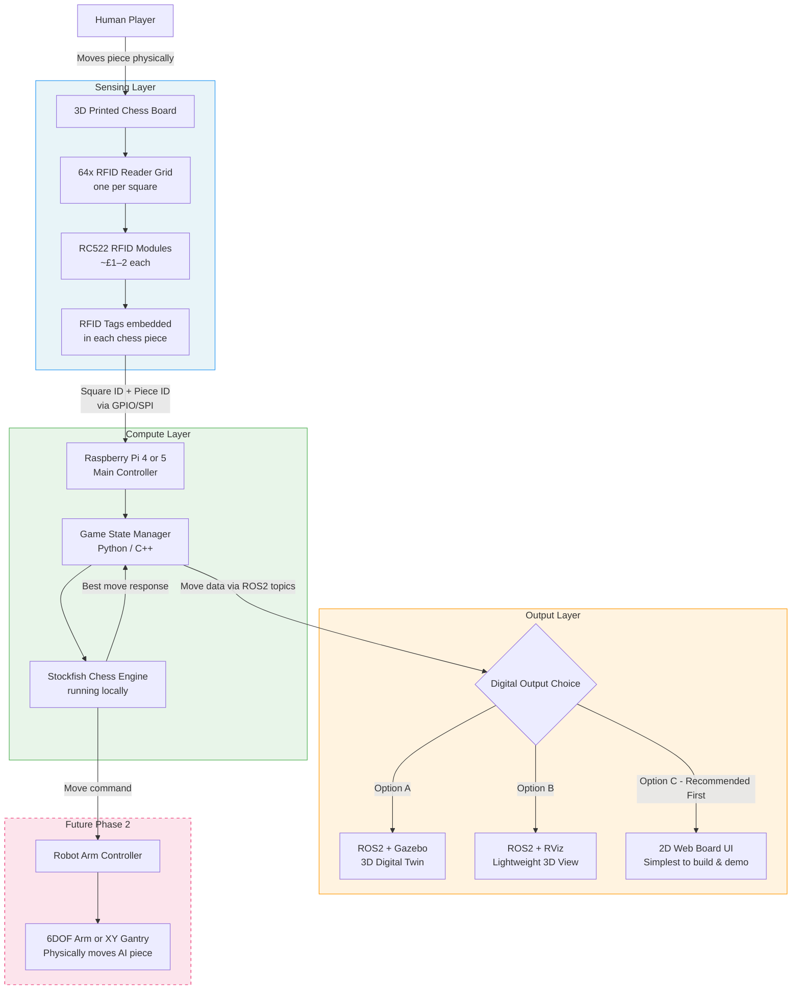
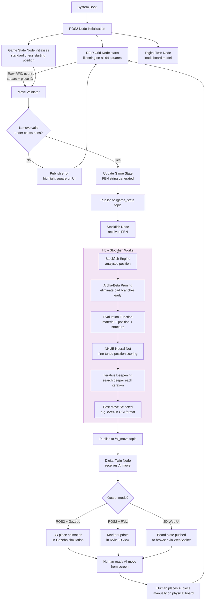

# Robotic Chess Project — Robotics Society Proposal

## Overview

A physical-digital hybrid chess system where a human plays on a real 3D-printed board, and an AI opponent (powered by Stockfish) responds via a digital twin. No robotic arm in Phase 1 — the AI's moves are shown digitally, and the human physically places them on the board.

---

## Project Goals

- Build a 3D-printed chess board and pieces with embedded RFID tracking
- Detect human moves via an RFID grid (one reader per square)
- Pass game state to a chess engine (Stockfish) running on a Raspberry Pi 4/5
- Display the AI's response move on a digital twin (ROS2/Gazebo, RViz, or a 2D board UI)
- Lay groundwork for a future robotic arm to physically move the AI's pieces

---

## Phase 1 Game Loop (Conceptual)

```
Human moves piece physically
        ↓
RFID detects source + destination square
        ↓
Game state updated on Raspberry Pi
        ↓
Stockfish calculates best response move
        ↓
Digital twin displays AI's move
        ↓
Human reads screen and places AI piece manually
        ↓
Repeat
```

---

## Hardware Flowchart



---

## Software Flowchart



---

## What is Stockfish?

Stockfish is a **free, open-source chess engine** — not an AI language model, but a highly optimised chess-specific search algorithm. It is consistently ranked among the strongest chess engines in the world and runs comfortably on a Raspberry Pi 4/5.

### How Stockfish Works

| Step | What Happens |
|------|-------------|
| **Input** | Receives board position as a FEN string (e.g. `rnbqkbnr/pppppppp/8/8/4P3/8/PPPP1PPP/RNBQKBNR`) |
| **Move generation** | Generates all legal moves from the current position |
| **Alpha-Beta Pruning** | Cuts branches of the search tree that cannot possibly be better than already-found moves — drastically reduces computation |
| **NNUE Evaluation** | A small neural network (trained on millions of games) scores each position for material, piece activity, king safety, and pawn structure |
| **Iterative Deepening** | Searches to depth 1, then 2, then 3... until time runs out, always keeping the best move found so far |
| **Output** | Returns best move in UCI format (e.g. `e2e4`) which your software translates to board coordinates |

### Why Stockfish over an LLM?

Large Language Models (like the ones powering conversational AI) are **poor chess players** — they predict text, not optimal moves. Stockfish is purpose-built for chess and will:

- Run on a Pi 4 with millisecond response times
- Be adjustable in difficulty (set `Skill Level 0–20`)
- Never make illegal moves
- Require no internet connection

---

## Compute Platform Recommendation

| Platform | Verdict | Reason |
|----------|---------|--------|
| **Raspberry Pi 4/5** | Recommended | Runs Stockfish + ROS2 + web UI simultaneously. Huge community support. |
| Jetson Nano | Overkill for now | GPU advantage wasted on Stockfish. Worth revisiting if you add computer vision. |
| Raspberry Pi Pico |Too underpowered | Cannot run Stockfish or ROS2. Suitable only as a peripheral controller. |

---

## Digital Twin Options

| Option | Complexity | Best For |
|--------|------------|----------|
| **2D Web Board UI** | Low — build first | Reliable demos, easy to develop, runs in any browser |
| **ROS2 + RViz** | Medium | Lightweight 3D visualisation, integrates cleanly with ROS2 topics |
| **ROS2 + Gazebo** | High | Full physics simulation, most impressive long-term, steep learning curve |

**Recommendation:** Build the 2D Web UI first. Add RViz/Gazebo as a stretch goal once the core pipeline works.

---

## Phased Roadmap

### Phase 1 — Core Pipeline (Current Scope)
- [x] 3D print board and pieces
- [ ] Wire 64x RC522 RFID readers into grid
- [ ] Connect grid to Raspberry Pi via SPI/GPIO
- [ ] Write RFID → game state parser
- [ ] Integrate Stockfish via UCI protocol
- [ ] Build 2D board UI or ROS2 digital twin
- [ ] End-to-end demo: human move → engine response → screen output

### Phase 2 — Actuation (Future)
- [ ] Design XY gantry or select robot arm
- [ ] Integrate move commands from Stockfish into motion controller
- [ ] AI physically moves its own pieces on the board
- [ ] Handle captures (move to tray)

### Phase 3 — Polish
- [ ] LED highlighting per square (valid moves, last move, check)
- [ ] Difficulty selector
- [ ] Full ROS2 + Gazebo digital twin
- [ ] Enclosure and cable management

---

## Key Risks & Mitigations

| Risk | Mitigation |
|------|------------|
| 64 RFID readers is complex to wire | Use SPI multiplexers; modular tile design helps isolate faults |
| ROS2 learning curve for software team | Start with simple 2D UI; ROS2 as stretch goal |
| RFID false reads / missed reads | Add software debouncing; require piece to be stable for 500ms before registering |
| Keeping physical board and digital twin in sync | Implement a "resync" button that re-scans all 64 squares |

---
