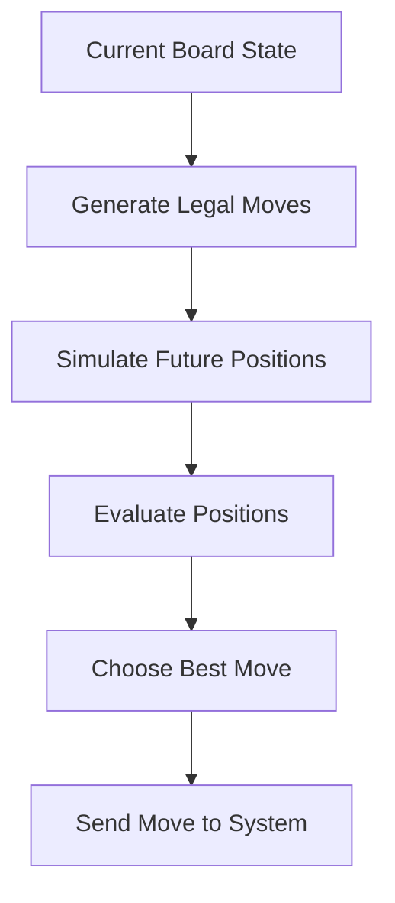
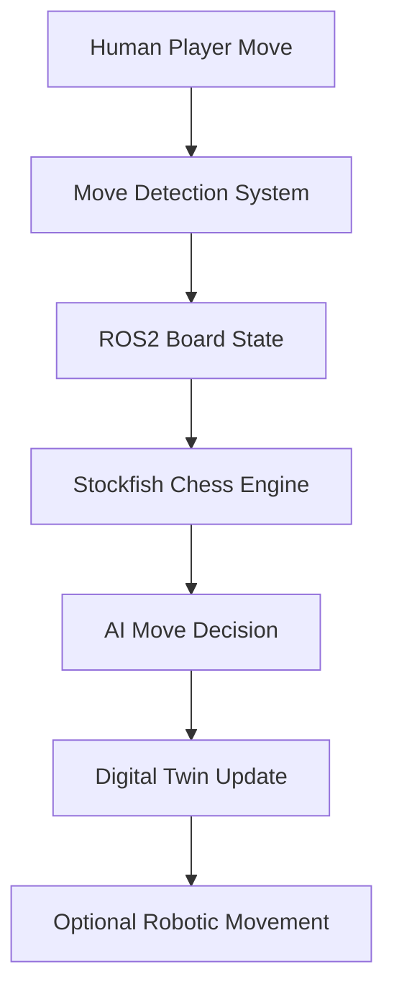

# Robotics Society Project Proposal  
# Modular Robotic Chess System with Digital Twin

## Project Overview

This project aims to develop a modular robotic chess platform that combines:

- Embedded systems
- Robotics
- AI-assisted gameplay
- Digital twins
- ROS2 integration
- 3D printing
- Simulation environments

The long-term vision is to create a physical chessboard capable of:

1. Detecting human player moves
2. Processing moves using a chess engine
3. Updating a digital twin in real time
4. Eventually enabling autonomous robotic movement of chess pieces

The project is intentionally modular so that different teams within the robotics society can work on separate areas simultaneously.

---

# Core Idea

The system consists of:

- A physical chessboard
- Smart sensing for move detection
- A chess AI opponent
- ROS2 middleware
- A digital twin in RViz or Gazebo
- Optional robotic movement system

---

# Main Goals

## Short-Term Goals

- Build a functional smart chessboard
- Detect player moves
- Integrate a chess engine
- Create a ROS2 digital twin

## Long-Term Goals

- Autonomous robotic piece movement
- AI commentary system
- Full simulation environment
- Online/networked functionality
- Tournament-ready autonomous board

---

# Why This Is a Strong Robotics Society Project

This project naturally divides into multiple disciplines:

| Area | Responsibilities |
|---|---|
| CAD Team | Board and piece design |
| Electronics Team | RFID/sensors/wiring |
| Embedded Team | MCU programming |
| ROS2 Team | Middleware and communication |
| Simulation Team | Gazebo/RViz digital twin |
| AI Team | Chess engine integration |
| Mechanical Team | Robotic movement system |
| UI Team | Dashboards and displays |

This makes it ideal for a society project because beginners and advanced members can contribute simultaneously.

---

# Proposed Hardware

## Main Compute Options

| Device | Purpose | Suitability |
|---|---|---|
| Raspberry Pi 5 | Main controller | Recommended |
| Jetson Nano | AI/computer vision | Optional |
| Raspberry Pi Pico | Sensor controller | Good peripheral MCU |

---

# Chessboard Detection Methods

## Option 1 — RFID System (Prototype)

### Idea

Each chess piece contains an RFID tag.

RFID readers underneath the board detect:
- Which piece is present
- Which square it occupies

### Advantages

- Easy to prototype
- Reliable identification
- Educational
- Low software complexity

### Disadvantages

- 64-square scaling issue
- Reader interference
- Complex wiring
- Cost increases rapidly

---

## Option 2 — Hall Effect / Magnetic Sensors

### Idea

Magnets inside pieces trigger sensors below the board.

### Advantages

- Cheap
- Reliable
- Common in smart chessboards
- Easier scaling

### Disadvantages

- Harder to identify exact piece type

---

## Option 3 — Computer Vision

### Idea

A camera above the board tracks movement using:
- OpenCV
- ArUco markers
- YOLO object detection

### Advantages

- Minimal board electronics
- Highly scalable
- Visually impressive

### Disadvantages

- Much harder software
- Lighting issues
- Calibration complexity

---

# Recommended Detection Architecture

A hybrid approach is likely best:

- Occupancy sensors detect movement
- RFID identifies piece type
- ROS2 manages board state

This balances reliability and complexity.

---

# Chess AI System

## Important Clarification

A traditional chess engine is significantly better than an LLM for gameplay.

The recommended engine is:

# Stockfish

:contentReference[oaicite:0]{index=0}

---

# What Is Stockfish?

Stockfish is:

- An open-source chess engine
- One of the strongest chess engines in the world
- Optimised specifically for chess calculations

It does NOT work like a Large Language Model.

Instead, it:
- Evaluates legal moves
- Calculates future board states
- Scores positions
- Selects the best move

---

# How Stockfish Works

## Simplified Process

1. Receives current board state
2. Generates all legal moves
3. Simulates future positions
4. Scores positions using evaluation functions
5. Chooses the strongest move

---

# Simplified Stockfish Flow

# AI Flow
